

<picture><source media="(prefers-color-scheme: dark)" srcset="assets/hero-dark.svg"></picture>

<picture><source media="(prefers-color-scheme: dark)" srcset="assets/social-l-dark.svg"></picture><a href="https://t.me/@itsswlame"><picture><source media="(prefers-color-scheme: dark)" srcset="assets/social-1-dark.svg"></picture></a><a href="https://github.com/wlame-dx"><picture><source media="(prefers-color-scheme: dark)" srcset="assets/social-2-dark.svg"></picture></a><a href="https://tiktok.com/@wlamefleet"><picture><source media="(prefers-color-scheme: dark)" srcset="assets/social-3-dark.svg"></picture></a><picture><source media="(prefers-color-scheme: dark)" srcset="assets/social-r-dark.svg"></picture>

<picture><source media="(prefers-color-scheme: dark)" srcset="assets/about-dark.svg"></picture>

<picture><source media="(prefers-color-scheme: dark)" srcset="assets/stack-dark.svg"></picture>

<a href="https://github.com/wlame-dx/game-optimizer"><picture><source media="(prefers-color-scheme: dark)" srcset="assets/project-game-optimizer-dark.svg"></picture></a>&nbsp;<a href="https://github.com/wlame-dx/sqlite-todoapp"><picture><source media="(prefers-color-scheme: dark)" srcset="assets/project-sqlite-todoapp-dark.svg"></picture></a>

<a href="https://github.com/wlame-dx/umbra"><picture><source media="(prefers-color-scheme: dark)" srcset="assets/project-umbra-dark.svg"></picture></a>&nbsp;<a href="https://github.com/wlame-dx/web"><picture><source media="(prefers-color-scheme: dark)" srcset="assets/project-web-dark.svg"></picture></a>

<a href="https://github.com/wlame-dx/winoptimizer"><picture><source media="(prefers-color-scheme: dark)" srcset="assets/project-winoptimizer-dark.svg"></picture></a>

<picture><source media="(prefers-color-scheme: dark)" srcset="assets/stats-dark.svg"></picture>

<picture><source media="(prefers-color-scheme: dark)" srcset="assets/streak-dark.svg"></picture>

<picture><source media="(prefers-color-scheme: dark)" srcset="assets/wave-dark.svg"></picture>

<a href="https://example.com"><picture><source media="(prefers-color-scheme: dark)" srcset="assets/button-1-dark.svg"></picture></a>&nbsp;&nbsp;<a href="https://github.com/wlame-dx?tab=repositories"><picture><source media="(prefers-color-scheme: dark)" srcset="assets/button-2-dark.svg"></picture></a>

<a href="https://metawka.github.io/expressive-profile/?from=wlame-dx"><picture><source media="(prefers-color-scheme: dark)" srcset="assets/credit-dark.svg"></picture></a>

